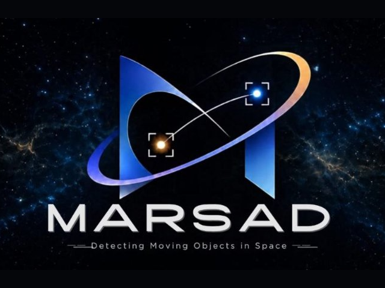

<p align="center">
  
</p>

<h1 align="center">MARSAD: Detecting Moving Objects in Space</h1>

<p align="center">
  <strong>Interactive Scientific Observatory for NASA SPHEREx All-Sky Time-Domain Spectroscopy</strong>
  <br />
  <em>Built for the 2026 NASA Space Apps Challenge</em>
</p>

<p align="center">
  <a href="https://nasa-2-xssz.vercel.app"></a>
  <a href="https://spherex.caltech.edu/"></a>
  <a href="https://irsa.ipac.caltech.edu/"></a>
  
  
</p>

---

## 🧭 Overview & Mission

**MARSAD** (Arabic for *Observatory / مَرْصَد*) is an interactive, science-grade research and exploration platform designed around NASA's revolutionary **SPHEREx** (*Spectro-Photometer for the History of the Universe, Epoch of Reionization, and Ices Explorer*) mission.

Operating from a polar Sun-synchronous Low Earth Orbit ($700\text{ km}$), SPHEREx scans the entire celestial vault every six months, dissecting every pixel into **102 near-infrared spectral channels** ($0.75\,\mu\text{m}$ to $5.00\,\mu\text{m}$). MARSAD harnesses this multi-epoch spectroscopic data to detect moving solar system bodies, track stellar proper motions, monitor variable stars, and analyze circumstellar biogenic ices.

> 🪐 **Live Deployment:** [https://nasa-2-xssz.vercel.app](https://nasa-2-xssz.vercel.app)  
> 📑 **Full Scientific Report:** Available in PDF format in the repository (`NASA_SPHEREx_2026_Full_Scientific_Report.pdf`).

---

## ✨ Key Features & Capabilities

```
┌─────────────────────────────────────────────────────────────────────────────┐
│                             MARSAD OBSERVATORY                              │
├──────────────────────┬──────────────────────┬───────────────────────────────┤
│ 🔭 Sky Map           │ 🌈 Spectral Explorer │ 📈 Variable Star Light Curves │
│ Multi-wavelength CDS │ 102 channels across  │ Multi-epoch photometry, Lomb- │
│ Aladin Lite WebGL    │ LVF arrays D1–D6     │ Scargle periods & CSV export  │
├──────────────────────┼──────────────────────┼───────────────────────────────┤
│ ⏱️ Epoch Comparator  │ ☄️ Asteroids (MOST)  │ ⚡ Proper Motion Vectors      │
│ Multi-epoch split-   │ JPL SBDB orbits &    │ Astrometric velocity tracking │
│ swipe difference     │ SPHEREx 80°–105° cone│ verified against Gaia DR3     │
└──────────────────────┴──────────────────────┴───────────────────────────────┘
```

### 1. 🌌 Interactive Multi-Wavelength Sky Map (`sky`)
- Integrated with the **CDS Strasbourg Aladin Lite v3** WebGL engine.
- Direct multi-survey layer toggles: **2MASS** (J/H/Ks), **AllWISE** (W1–W4 mid-IR), **DSS2 Optical Color**, and **Pan-STARRS1 DR1**.
- Calibrated field of view ($3.5^\circ \times 11.3^\circ$ detector footprint) and J2000 coordinate overlays.

### 2. 🌈 102-Band Spectral Explorer (`spectral`)
- Complete dispersion mapping across six Linear Variable Filter arrays (D1 to D6).
- Resolving power $R = \lambda / \Delta\lambda$ scaling from $35$ to $130$.
- Interactive Spectral Energy Distributions (SED) revealing water ice ($3.05\,\mu\text{m}$), $CO_2$ ice ($4.27\,\mu\text{m}$), $CO$ ice ($4.67\,\mu\text{m}$), and methane ($CH_4$).

### 3. 📈 Photometric Light Curves & Periodograms (`variable`)
- Calibrated time-series photometry across observation epochs with $\pm 1\sigma$ error bars.
- Lomb-Scargle period analysis and phase-folded light curves for pulsating and eclipsing systems.
- 1-click **CSV data export** with full astrometric header metadata ($d$, $\mu$, $\pi$, ICRS).

### 4. ⏱️ Time-Domain Observation Comparator (`timeline`)
- Split-screen swipe slider comparing observations separated across months or years.
- Multi-mode difference imaging ($D = (I_2 - B_2) - \alpha(I_1 - B_1)$) isolating $>3\sigma$ photometric variations and transients.
- High-speed blink comparator ($1 - 4\text{ Hz}$) to spot positional shifts immediately.

### 5. ☄️ Solar System Moving Object Search Tool (`most`)
- Emulation of NASA's **SPHEREx MOST** tool integrated with the **JPL Small-Body Database (SBDB)**.
- Real-time Keplerian ephemeris calculation for near-Earth and main-belt asteroids (**1 Ceres**, **4 Vesta**, **12 Victoria**, **433 Eros**).
- Interactive SPHEREx solar elongation survey cone ($80^\circ - 105^\circ$) validating observational visibility.

### 6. ⚡ Proper Motion Vector Field (`motion`)
- Astrometric centroid determination verified against **ESA Gaia DR3** catalog parameters.
- High proper motion tracking ($\mu$ in arcsec/year, position angle $\theta$, and kinematic displacement vectors).

### 7. 🛡️ Provenance & FITS Header Inspector (`provenance`)
- Level-2 calibrated FITS header inspector compliant with IVOA SIAv2 standards.
- Transparent data lineage labeling (**Observed / Calibrated Archive** vs **Simulation Model**).
- Direct archive query links to NASA/IPAC IRSA.

---

## 🎯 Authoritative Scientific Target Benchmark

MARSAD is calibrated and tested against five distinct astrophysical targets:

| Target | Object Type | Distance ($d$) | Proper Motion ($\mu$) | Scientific Phenomenon |
|---|---|---:|---:|---|
| **Barnard's Star** | M4.0V Red Dwarf | $1.8282\text{ pc}$ | $10.393''/\text{yr}$ | Ultra-high proper motion & Gaia DR3 vector validation |
| **Epsilon Indi B** | T1.5V + T6V Binary Dwarf | $3.6385\text{ pc}$ | $4.679''/\text{yr}$ | Atmospheric methane ($CH_4$) & water vapor absorption |
| **WISE 0855** | Y-Dwarf ($T \approx 250\text{ K}$) | $2.2780\text{ pc}$ | $8.146''/\text{yr}$ | Coldest sub-stellar object & water-ice clouds in Array 6 |
| **RW Aurigae** | Classical T Tauri Star | $166.8\text{ pc}$ | $0.0214''/\text{yr}$ | Circumstellar accretion disk occultation & extinction |
| **R Draconis** | Mira Pulsating Giant | $440.5\text{ pc}$ | $0.0275''/\text{yr}$ | Long-period stellar pulsation ($P = 245.6\text{ d}$) in near-IR |

---

## 🛠️ Technology Stack

| Domain | Technologies |
|---|---|
| **Frontend Framework** | **React 19**, **TypeScript 5.9**, **Vite 7** |
| **Styling & Theme** | **Tailwind CSS v4**, **Tailwind Merge**, **Clsx**, Custom Infrared Dark Palette |
| **3D & Visual Engines** | **Three.js**, **Procedural Canvas API (60+ FPS)**, **WebGL Fluid Engine** |
| **Smooth Interaction** | **Lenis Smooth Scroll**, Custom Kinetic Scrollytelling Engine |
| **Astronomical Engines**| **CDS Aladin Lite (WebGL)**, **HiPS Multi-Wavelength Surveys (2MASS, AllWISE, DSS2, Pan-STARRS)** |
| **Ephemerides & Orbits**| **JPL Small-Body Database (SBDB)**, **JPL Horizons**, SPHEREx MOST Algorithm |
| **Backend & REST API** | **Node.js 22**, **Express.js v5**, **Dual-Layer Fallback Cache** |
| **Testing & QA** | **109 Automated Scientific Tests**, **42 E2E Integration Tests**, **Puppeteer Headless Automation** |
| **Hosting & CI/CD** | **Vercel Edge Network**, **GitHub Actions Continuous Deployment** |

---

## 🚀 Quick Start Guide

### Prerequisites
- **Node.js**: v18.0.0 or later (v20+ / v22 recommended)
- **npm**: v9.0.0 or later

### 1. Clone & Install
```bash
git clone https://github.com/novexvx-commits/nasa_2.git
cd nasa_2
npm install
```

### 2. Launch Development Server
```bash
# Runs Express scientific backend and Vite client concurrently
npm run dev
```
Open **[http://localhost:5173](http://localhost:5173)** in your browser.

### 3. Run Automated Tests
```bash
# 1. Scientific calculations & 5-target validation (109 tests)
npm test

# 2. End-to-end API integration tests (42 tests)
npm run test:e2e

# 3. Live dual-channel endpoint verification
npm run test:live
```

### 4. Build for Production
```bash
npm run build
```
Generates an optimized, single-file distribution bundle in `dist/index.html`.

---

## 📂 Repository Structure

```
├── server/                                # Scientific Node.js / Express Backend
│   ├── server.js                          # Express server with CORS & SPA fallback
│   ├── routes/api.js                      # REST API endpoints (/api/*)
│   ├── services/                          # Specialized astronomical services
│   │   ├── irsaTapService.js              # NASA/IPAC IRSA SIAv2 & TAP query client
│   │   ├── photometryService.js           # Multi-band photometry & CSV export
│   │   ├── motionService.js               # Centroid vectors & Gaia DR3 validation
│   │   ├── spectralService.js             # 102-band LVF dispersion models
│   │   └── mostMovingObjectService.js     # JPL SBDB asteroid orbit calculator
│   └── test/                              # Automated test suites
├── src/                                   # Modern React 19 Frontend
│   ├── pages/
│   │   ├── HomePage.tsx                   # Cinematic scrollytelling narrative
│   │   └── ExperiencePage.tsx             # Standalone MARSAD Observatory workstation
│   ├── components/spherex/                # 7 Specialized scientific workstation tabs
│   │   ├── SpherexHub.tsx                 # Master command station & target navigation
│   │   ├── AladinSkyExplorer.tsx          # Celestial sky map (CDS Aladin Lite)
│   │   ├── VariableStarLightCurve.tsx     # Photometric time-series & CSV export
│   │   ├── SpectralBandExplorer.tsx       # 102-channel LVF filter explorer
│   │   ├── ObservationTimelineComparator.tsx # Split-screen comparator & difference engine
│   │   ├── MostSolarSystemExplorer.tsx    # Asteroids MOST & orbital ephemerides
│   │   ├── MotionDetectionViewer.tsx      # Proper motion vectors & Gaia comparison
│   │   └── ProvenanceInspector.tsx        # FITS header & data lineage inspector
│   └── sections/                          # Narrative chapters (Hero, Spacewalk, Timeline, etc.)
├── public/                                # Public assets (Logo, Favicon, 3D Models)
└── index.html                             # HTML5 entry with metadata & favicon
```

---

## 📜 Scientific Attribution & Acknowledgments

- **NASA / JPL-Caltech / IPAC Infrared Science Archive (IRSA)** for SPHEREx mission parameters, SIAv2 protocols, and archival data.
- **Centre de Données astronomiques de Strasbourg (CDS)** for the Aladin Lite WebGL engine and SIMBAD Sesame services.
- **European Space Agency (ESA) Gaia Mission** for Gaia Data Release 3 astrometric reference baselines.
- **NASA Jet Propulsion Laboratory (JPL)** for Solar System Dynamics and the Small-Body Database (SBDB).

---

<p align="center">
  <sub>Developed with passion for the <strong>2026 NASA Space Apps Challenge</strong>.</sub>
  <br />
  <sub>© 2026 MARSAD Platform · Licensed under the MIT License.</sub>
</p>
